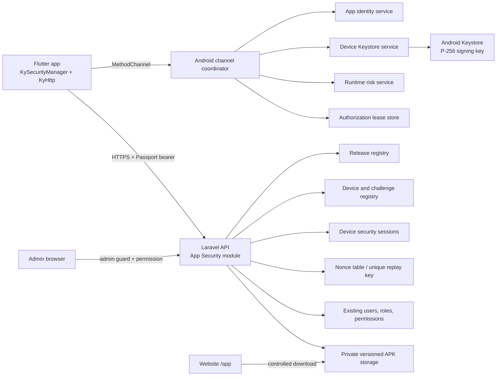

# App Security architecture

## Current deployment shape

The Flutter app and Laravel website/API are separate repositories but share the same production host. Laravel is the authoritative gate for release identity, device approval, sessions, request signatures, and existing role/permission checks. The current feature flag defaults to off so the mobile client and server can be deployed in stages.



The deployment currently uses the Laravel database and local private storage. Redis and asynchronous security jobs are not integrated. No business API should treat a client-side integrity result as authorization.

## Registration and request sequence

```mermaid
sequenceDiagram
  participant App as Flutter
  participant Native as Android Keystore
  participant API as Laravel App Security API
  participant DB as Laravel database
  App->>API: GET config
  App->>API: POST releases/check (package, signer, version)
  App->>API: POST devices/status (installation UUID)
  alt no device record
    App->>API: POST challenge
    API->>DB: persist hashed, expiring challenge
    API-->>App: challenge UUID + challenge
    App->>Native: create/access P-256 key; sign challenge proof
    Native-->>App: public key + attestation certificates if supplied
    App->>API: POST devices/register
    API->>DB: verify release/proof/attestation policy; persist device, signals, and risk history
  end
  opt device approved
    App->>API: POST sessions
    API->>DB: persist token hashes and expiration
    App->>API: signed POST heartbeat on configured interval
  end
  App->>Native: sign canonical request
  App->>API: authenticated business request + signature headers
  API->>DB: verify release/device/session/signature; consume unique nonce
  API-->>App: business response or app_security denial
```

## Trust boundaries

- Android Keystore private key material is not exported by this implementation. Public key and certificate-chain data are sent during registration.
- Release metadata is extracted from the uploaded APK with configured Android SDK `aapt` and `apksigner`; a trusted signer list is required before publication.
- Device registration proof and API requests use P-256 ECDSA/SHA-256 signatures.
- Laravel stores hashes of session and refresh tokens. Attestation chains are encrypted at rest; when configured roots and fresh revocation data are available, the server validates the chain, key/app binding, challenge, hardware key parameters, and verified-boot state. Otherwise evidence stays pending and unverified.
- Existing Laravel user roles and mobile permission middleware remain responsible for business authorization after App Security middleware succeeds.

## Deliberate limits

Native Android responsibilities are split across `KySecurityMethodChannels`, `AndroidAppIdentity`, `AndroidDeviceKeyStore`, `AndroidRuntimeRiskSignals`, and `AndroidAuthorizationLeaseStore`; `MainActivity` only wires the coordinator, date/time settings, and NFC lifecycle. Certificate pinning is implemented in the shared Dart HTTP and Dio transports and fails closed on the official API host; actual production primary/backup pins still require secure provisioning. Android cleartext traffic is allowed only in debug builds and disabled in release builds. Play Integrity and location intelligence are not implemented; neither is required for the sideloaded distribution baseline. Targeted user inbox notifications and optional FCM delivery for registration/device-state events are implemented, with FCM disabled until credentials and workers are configured. Registration checks for the same public-key fingerprint already bound to a different account, keeps the new account pending and raises a review alert; it does not flag shared installation UUIDs with separate keys. Registration-velocity review uses a short-lived HMAC-keyed source-IP cache counter, can hold customer auto-approval and raise an admin alert, and never auto-blocks. Short-lived signed offline authorization leases are implemented behind a default-off grace setting; Android verifies and encrypts them using Android Keystore and rejects them after reboot or monotonic expiry. Production keys and physical-device behavior still require provisioning and tests. Android reports best-effort VPN and Wi-Fi/cellular/Ethernet transport indicators for review; these signals are client-modifiable and never auto-block. Server-side security alerts cover new installations, high-risk transitions, device state changes, and release publication/revocation; email delivery is queued and disabled until configured. Pending registrations and device status transitions also enqueue per-user mobile inbox records with stable dedupe keys and optionally use the existing Firebase sender; the FCM feature flag is off until credentials and workers are configured. The server records daily authorized request counts and changes in HMAC-hashed server-observed public IPs; it does not retain raw IP history in the intelligence table. See [implementation status](implementation-status.md).

